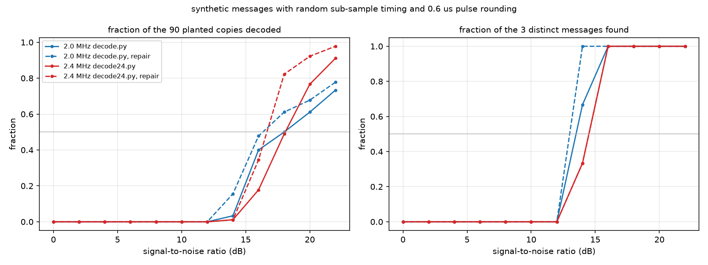

# A from-scratch ADS-B receiver in Python, measured against dump1090

Aircraft broadcast their identity, altitude, position and speed on 1090 MHz as short pulse bursts
(Mode S / ADS-B). [dump1090](https://github.com/antirez/dump1090) is the well-known C decoder for
these signals. This project asks one question: **how close can a receiver written from scratch in
Python, using only numpy, get to dump1090?**

Everything here was written without reusing dump1090's demodulator: preamble detection, bit slicing,
the 24-bit checksum, a bit-repair step, message field decoding and position decoding. The radio is
an RTL-SDR USB dongle.

## Short answer

- On dump1090's own test recording, the Python receiver recovers **78 of the 85** ADS-B messages
  dump1090 finds (**92 %**), with **zero false messages**.
- On synthetic recordings with known contents it never produced a false message, at any noise level.
- A second decoder for 2.4 million samples per second finds **about 1.6 times as many messages** as the 2.0 MHz decoder on the same live recordings.
- Field decoding agrees with dump1090: for every aircraft both programs heard, the decoded callsign
  is the same.

## How the receiver works

1. **Magnitude.** The dongle delivers I/Q byte pairs; the receiver keeps only signal strength,
   `|I + jQ|`.
2. **Preamble.** Every message starts with four 0.5 µs pulses in a fixed pattern. Correlating the
   magnitude with that pattern gives a score per sample; any local peak above *k* times the median
   score (*k* = 3) is a candidate message start.
3. **Bits.** Each bit is a 1 µs slot with the pulse in the first half (1) or the second half (0)
   — pulse-position modulation. At 2.0 MHz a half-bit is exactly one sample, so `decode.py`
   compares sample pairs. At 2.4 MHz a half-bit is 1.2 samples and no fixed pair works, so
   `decode24.py` finds the message start to 1/16 of a sample and reads each half-bit window at its
   exact centre by interpolation.
4. **Checksum.** The last 24 bits are a CRC; only messages that pass are kept. Overlapping reads of
   the same burst are resolved by keeping the one with the stronger preamble.
5. **Repair (optional).** If the checksum fails, flip the least confident bit, then the next least
   confident, and so on, accepting the message only if the checksum then passes.
6. **Fields and positions.** `fields.py` decodes type codes, callsigns, altitude and velocity;
   position decoding implements Compact Position Reporting from even/odd message pairs or from one
   message plus a nearby reference point.

## Results

### Against dump1090 on its test recording

The answer key is the 85 ADS-B messages dump1090 decodes from the first 270,000 samples of
`testfiles/modes1.bin`, the recording that ships with dump1090. `versions.py` replays every version
of the decoder from the git history against that same key:

| version | found | missed | false | recovery |
|---|---:|---:|---:|---:|
| Sep 28: strict preamble, k=4 | 55 | 30 | 0 | 65 % |
| Oct 5: any preamble, k=3 | 76 | 9 | 0 | 89 % |
| Oct 7: keep the stronger of overlapping reads | 76 | 9 | 0 | 89 % |
| Oct 7: same, with bit repair | **78** | **7** | **0** | **92 %** |

Lowering the threshold below *k* = 3 finds nothing new and starts producing false messages (8 at
*k* = 2), so *k* = 3 is the setting used throughout.

**What the 7 misses are.** Four were never detected as candidates at all. The other five were
detected but had bits misread; repair recovers the two that had a single wrong bit. The three that
remain have 3 to 7 wrong bits each, and their pulses are smeared: a straight-line timing fit
correlates at about 0.86, against 0.94 or higher for clean messages. The most likely causes are an echo
arriving a fraction of a microsecond late or the dongle's gain control reacting to a strong signal;
they remain unexplained.

### Synthetic noise sweep

`synth.py` plants 90 copies of 3 known messages in noise, with random sub-sample timing and the
pulse rounding measured on the real dongle (about 0.6 µs), and the decoders are run at each
signal-to-noise ratio. Across the whole sweep **no false message was ever produced.**



| decoder | half of planted copies decoded at |
|---|---:|
| 2.0 MHz `decode.py` | 18.0 dB |
| 2.0 MHz `decode.py`, with repair | 16.3 dB |
| 2.4 MHz `decode24.py` | 18.1 dB |
| 2.4 MHz `decode24.py`, with repair | 16.7 dB |

Repair buys about 1.5 dB. On clean synthetic data the two sample rates are close; the 2.4 MHz
decoder pulls ahead above 18 dB, reaching 98 % of copies at 22 dB against 78 %.

### 2.0 vs 2.4 MHz on live recordings

Eight one-minute raw I/Q recordings were taken at 2.4 MHz. Each was decoded natively by
`decode24.py` and, after resampling to 2.0 MHz, by `decode.py` (`compare24.py`). One recording was
silent. Totals over the other seven:

| decoder | repair | distinct ADS-B messages | addresses seen only once |
|---|---|---:|---:|
| 2.0 MHz `decode.py` | off | 541 | 2 |
| 2.0 MHz `decode.py` | on | 629 | 5 |
| 2.4 MHz `decode24.py` | off | 872 | 1 |
| 2.4 MHz `decode24.py` | on | **1041** | 1 |

With repair on, 551 messages were found by both decoders, 491 only at 2.4 MHz and 79 only at
2.0 MHz. An aircraft address that appears in only one message of a recording is the signature of a
false message that happened to pass the checksum, so the last column is an upper bound on false
messages: at most a handful in about a thousand.

On real signals 2.4 MHz is clearly better, more so than the synthetic sweep suggests; the real
pulses are less tidy than the model.

## Limitations

- The comparison against dump1090 rests on one short test recording (85 messages). It measures
  agreement with dump1090, not with ground truth: anything dump1090 itself misses is invisible here.
- The live recordings have no reference decoder, so that comparison is between the two Python
  decoders only.
- The receiver is offline: it decodes recorded files, not a live stream, and has not been tuned
  for speed.

## Reproducing

Requires Python 3 with numpy, scipy and matplotlib, and a clone of dump1090 next to this folder
(`../dump1090`) for `testfiles/modes1.bin`.

```bash
pytest tests                  # checksum, decoding and position tests
python synth.py               # synthetic recording with known messages
python sweep_rates.py         # noise sweep, writes results/sweep_rates.png
```

`compare.py` and `versions.py` need dump1090's decode of the test recording as the answer key:
run dump1090 on `testfiles/modes1.bin` and save its raw message output as
`../dump1090/truth_modes1.txt`. `compare24.py` takes raw 2.4 MHz recordings made with `rtl_sdr`.

The `service/` folder holds the launchd jobs used to keep a receiver recording unattended on macOS.
